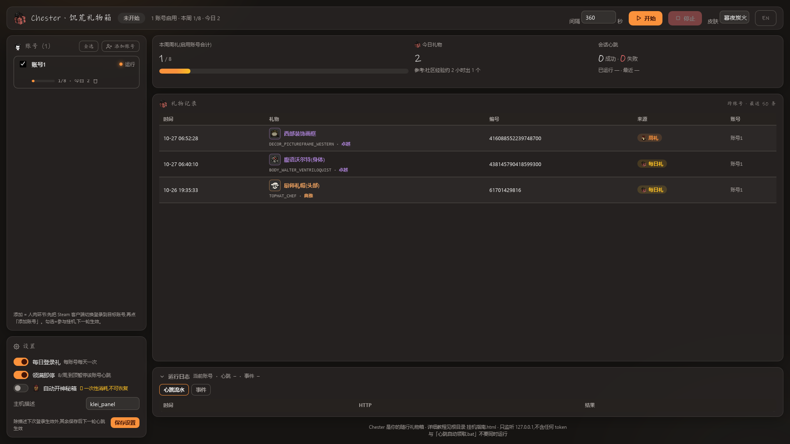
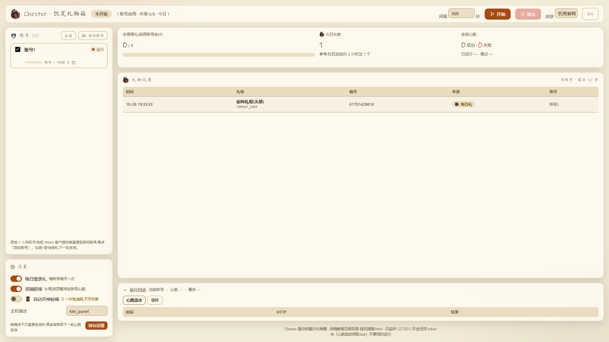
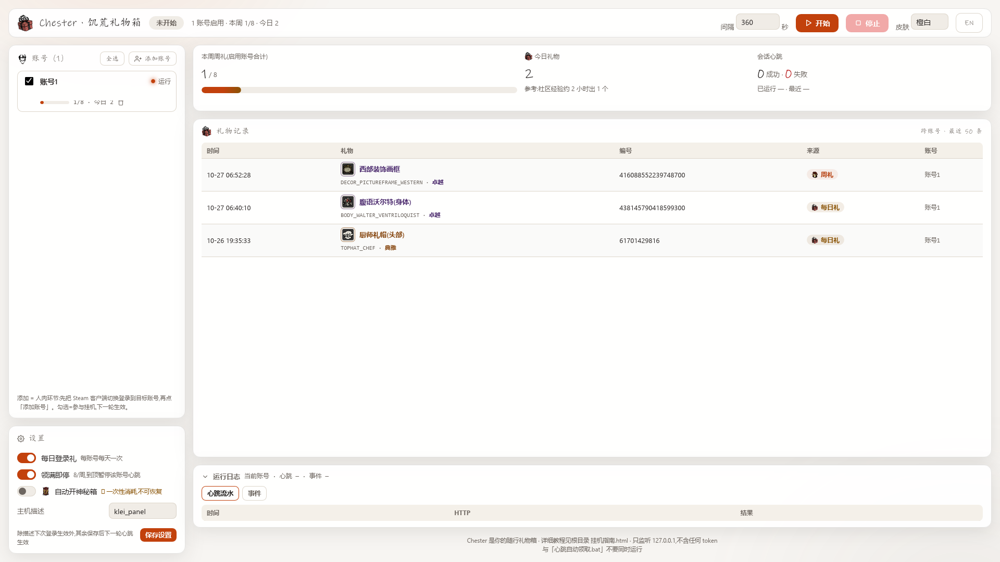
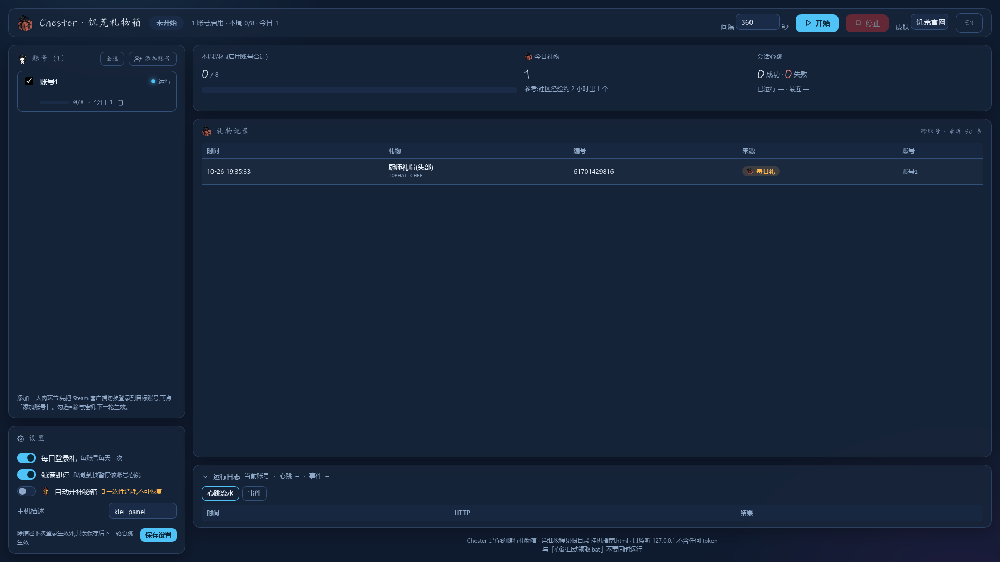
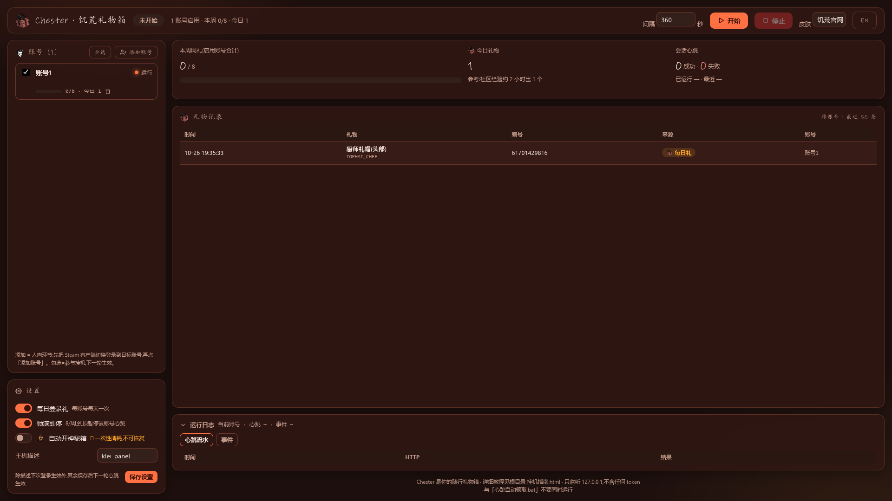

# 📦 Chester

**Farm Don't Starve Together weekly gifts in the background — no game launch needed.**

[**English**](README.en.md) | [**中文**](README.md)

*Ember Night theme · gifts auto-annotated with game icons, localized names and rarity colors*

| Official (default) | Orange & White | Winter Gold | Forge Embers |
|---|---|---|---|
|  |  |  |  |

## ✨ What it does

| | |
|---|---|
| 🎁 **Auto-claim weekly gifts** | Heartbeats Klei every 360 s; gifts are receipted, opened and filed automatically. Weekly cap 8/8 with auto-pause. |
| 🌙 **No game launch** | Logs in with a Steam session ticket; day-to-day it is pure HTTP — even the Steam client can stay closed. |
| 👥 **Multi-account checkboxes** | One manual login per account, then tick-and-farm. Accounts stagger automatically, each with its own SQLite database. |
| 🖼️ **3392-skin icon dex** | Every gift is annotated with its game icon, official English name and rarity color (data from dst-skins-checklist). |
| 🎨 **7 themes / CN & EN UI** | Official (bright parchment), Orange & White, Ember Night, Winter Gold, Forge Embers, Moonlight, Evergreen. |
| 🩹 **Self-healing** | Token expiry auto-renew/re-login, offline back-off, unopened-gift queue auto-clear. Just leave it running. |

## ⚡ Quick start

1. Install **64-bit Python 3.8+** and sign into the Steam client (launching DST is not required).
2. Double-click **`启动控制面板.bat`** (the panel launcher) — it opens `http://127.0.0.1:8377`.
3. Click **▶ 开始** and wait for a "heartbeat ok" line. Full illustrated guide: [挂机指南.html](挂机指南.html) (Chinese).

> ⚠️ Not affiliated with Klei Entertainment. Automating gift collection may violate the game's
> Terms of Service — use at your own risk, for personal and educational purposes only.

## 🧠 How it works

- **Login** — takes a session ticket from the local, signed-in Steam client (`steam_api64.dll` via ctypes)
  and exchanges it at `login.kleientertainment.com/login/LoginViaSteam` for a 60-min GameSessionToken —
  the very same request the game's main menu sends.
- **Heartbeat** — every 360 s it POSTs `clientitems/DST/Tick`; the server advances your weekly drop progress.
- **Claiming** — on `GiftReceived.Key`: verify receipt → find unopened items (`Context==3`) → `SetItemOpened` each one.
- **Renewal** — tokens last 60 min and are chain-renewed via `TokenPurpose` (verified ≥2 hops), so Steam
  is only needed once per account.
- **Strategy** — weekly gifts cap at 8/week (sliding 7-day window, auto-pause/resume), plus the separate
  DailyGift endpoint every 24h per account (rolling).

## 👥 Adding accounts

Each account needs **one manual login**: switch the Steam client to that account and click
*Add account* in the panel (or export a session file with `python klei_steam_login.py --json` on the
account owner's machine). Afterwards the panel renews everything over HTTP. If an account's chain
breaks (e.g. the owner plays DST elsewhere), only that account pauses — switch/toggle it to retry.

## 🔒 Security notes

- Tokens equal a Klei login credential: `credentials/` is git-ignored and must never be shared.
- The panel listens on `127.0.0.1` only, validates the Host header, whitelists routes, never
  returns tokens, and masks user IDs in logs/stats.
- No game files are modified; no injection; only plain HTTP requests identical to the game's own.

## 📚 More docs (Chinese)

| File | Content |
|---|---|
| [挂机指南.html](挂机指南.html) | Illustrated beginner guide (double-click to open) |
| [docs/协议-登录与会话.md](docs/协议-登录与会话.md) | C-layer login flow reverse engineering |
| [docs/协议-心跳与礼物.md](docs/协议-心跳与礼物.md) | Heartbeat / gift protocol |
| [docs/多账号路线图.md](docs/多账号路线图.md) | Multi-account design (L0/L1/L2 fallback) |
| [docs/协议-服务器查询.md](docs/协议-服务器查询.md) | Server browser reverse engineering + `dst_servers.py` tool |
| [docs/协议-Klei接口总表.md](docs/协议-Klei接口总表.md) | Full Klei endpoint catalog mined from the client |
| [docs/情报-社区与SDK调研_2026-10-26.md](docs/情报-社区与SDK调研_2026-10-26.md) | SDK signature evolution, SteamKit2, community intel |

## 🧾 Changelog (abridged)

- **v1.2** — renamed to Chester; visual polish pass.
- **v5.7.2** — skin DB refreshed to 3,392 items (+439 with icons: backpacks, bedrolls, formal wear…); gift-pool items now 100% Chinese-labeled (lexicon +300 words).
- **v1.1f** — full palette redesign + Orange & White theme (7 total); rarity colors; 2953-skin
  database wired into the panel (icons / names / rarity).
- **v1.1e** — theme system.
- **v1.1** — web panel (persistent settings, stats, gift monitor, per-account SQLite), ticket call
  hardened (5-arg identity=NULL), weekly cap auto-stop, DailyGift endpoint.
- **v1.0** — initial protocol reverse engineering, verified end-to-end on live servers (2026-08-30),
  re-verified against the current build (2026-10-26).

## 📜 License & disclaimer

MIT — see [LICENSE](LICENSE). Not affiliated with Klei Entertainment. Automating gift collection
may violate the game's Terms of Service: use at your own risk, personal and educational use only.
Game icons and the "Don't Starve" wordmark are © Klei Entertainment, used here as non-commercial
identifiers; skin metadata/icons courtesy of [dst-skins-checklist](https://dst-skins-checklist.github.io/).
